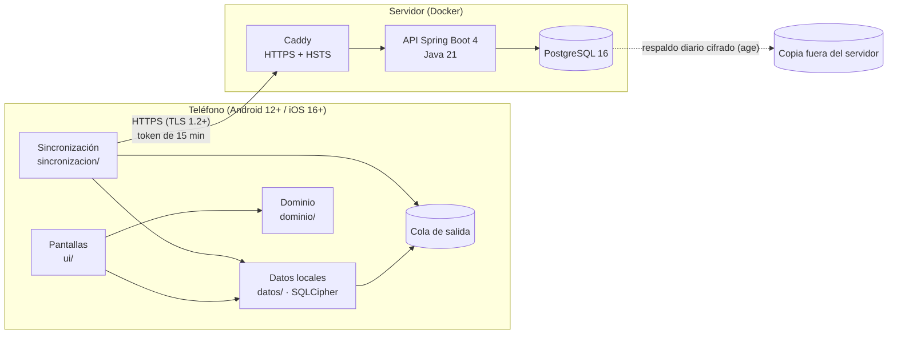
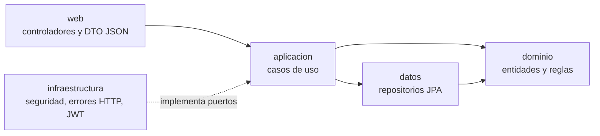
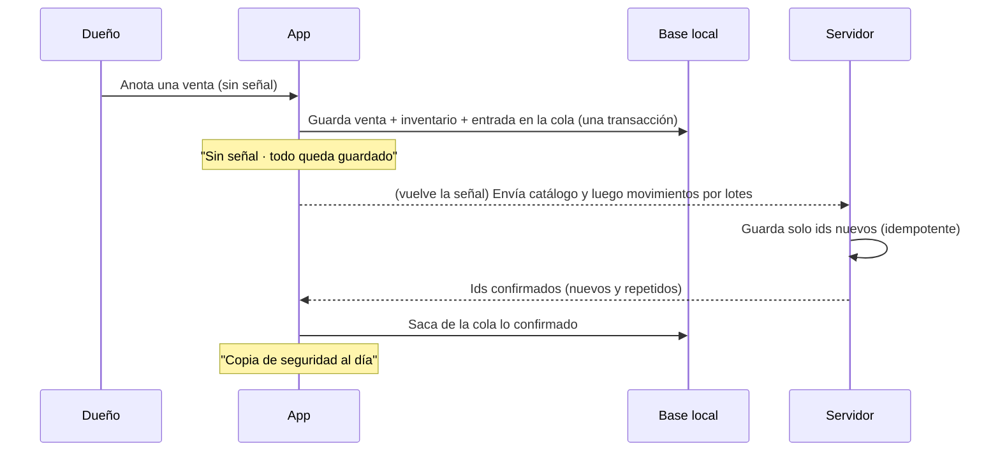

# 2. Arquitectura



Principio rector: **el teléfono es la fuente de verdad para operar**. Todo se escribe primero en la base local; el servidor guarda la copia de seguridad y permite restaurar. Las decisiones con su contexto están en [decisiones-de-arquitectura.md](decisiones-de-arquitectura.md).

## API

Arquitectura limpia por módulo. Cada módulo de negocio tiene cuatro capas y las dependencias solo apuntan hacia adentro:



| Capa | Responsabilidad | Regla |
|---|---|---|
| `web` | Traducir JSON ↔ dominio, validar formato, devolver el código HTTP | No contiene lógica del negocio |
| `aplicacion` | Un caso de uso por clase, transacciones | No conoce HTTP ni JSON; lanza `ErrorDeNegocio` |
| `dominio` | Entidades y sus reglas (bloqueo por intentos, fusión por campo, inmutabilidad) | No depende de ninguna otra capa |
| `datos` | Consultas a PostgreSQL (Spring Data JPA) | Siempre filtra por el negocio dueño |
| `infraestructura` | Seguridad (JWT, filtros, límites, cabeceras), traducción de errores a HTTP | Implementa puertos como `EmisorTokens` |

```
backend/src/main/java/co/caporal/api/
├── comun/                  ErrorDeNegocio (reglas no cumplidas, sin HTTP)
├── cuenta/                 registro, ingreso, sesiones y borrado de cuenta
│   ├── web/                AuthController, SesionController, CuentaController, AuthDtos
│   ├── aplicacion/         RegistrarNegocio, IngresarNegocio, Sesiones, EliminarCuenta, EmisorTokens (puerto)
│   ├── dominio/            Usuario, SesionRenovable
│   └── datos/              UsuarioRepository, SesionRepository
├── sincronizacion/         movimientos de dinero
│   ├── web/                SyncController, SyncDtos
│   ├── aplicacion/         RecibirMovimientos, EntregarMovimientos
│   ├── dominio/            Movimiento, TipoMovimiento
│   └── datos/              MovimientoRepository
├── catalogo/               productos e inventario
│   ├── web/  aplicacion/SincronizarCatalogo  dominio/Producto, MovInventario  datos/
├── respaldo/               restaurar un teléfono
│   ├── web/  aplicacion/RestaurarRespaldo
├── auditoria/              RegistroSeguridad (eventos de seguridad sin datos personales)
└── infraestructura/
    ├── seguridad/          SecurityConfig, JwtService, JwtAuthFilter, RateLimitFilter
    └── web/                ManejadorErrores
```

Migraciones de base de datos: `backend/src/main/resources/db/migration/` (Flyway, V1 a V7).

## App

Flutter, organizada por responsabilidad:

```
mobile/lib/
├── main.dart               arranque: abre la base cifrada y conecta las piezas
├── config.dart             dirección de la API y número de soporte (por --dart-define)
├── dominio/                modelos y reglas puras: Movimiento, Producto, resúmenes, reglas de cobro,
│                           formato de pesos
├── datos/                  base local (SQLCipher, migraciones), cola de salida, Repositorio,
│                           Inventario, Clientes, Comprobantes
├── sincronizacion/         Sesion (tokens en Keychain/Keystore), Sincronizador, envíos por tipo,
│                           Restauracion, cliente HTTP
└── ui/
    ├── comun/              tema, componentes, logo, formulario guiado
    ├── inicio/             splash, bienvenida, navegación y pantalla de inicio
    ├── cuenta/             ingreso, registro, PIN, recuperar clave
    ├── anotar/             Vendí, Gasté, Fié, lista de la venta, pedido, confirmación
    ├── clientes/           Le deben, cliente, cobrar por WhatsApp, registrar pago y comprobante
    ├── inventario/         inventario, producto, nuevo producto, cantidades
    ├── movimientos/        historial, detalle y corrección, resumen
    └── ajustes/            mis datos, mi negocio, privacidad, estado de envío, ayuda
```

Reglas: las pantallas no hablan con la base de datos directamente, usan `Repositorio`, `Inventario`, `Clientes` o `Comprobantes`; solo `sincronizacion/` habla con el servidor; `dominio/` no depende de Flutter ni de la base.

## Sincronización



- **Ids únicos desde el teléfono (UUID):** reenviar no duplica nada.
- **Movimientos inmutables:** una corrección es un movimiento de reverso; no hay conflictos de edición.
- **Productos:** cada campo guarda cuándo cambió y gana el cambio más reciente.
- **Sesión:** acceso de 15 minutos que la app renueva sola; el token de renovación es de un solo uso y reutilizarlo cierra todas las sesiones.
- **Restauración y varios celulares:** al entrar en un teléfono vacío, la app pide todos los cambios de la cuenta (`/sync/cambios` sin `desde`). Después, cada minuto, pide solo lo que llegó desde la última vez: así dos celulares del mismo negocio ven lo que anota el otro. Lo traído se guarda sin volver a encolarlo y sin duplicar.
- **Ventana segura:** el servidor entrega los cambios hasta unos segundos antes de ahora; lo que se está guardando en ese instante llega en la consulta siguiente, nunca se salta.
