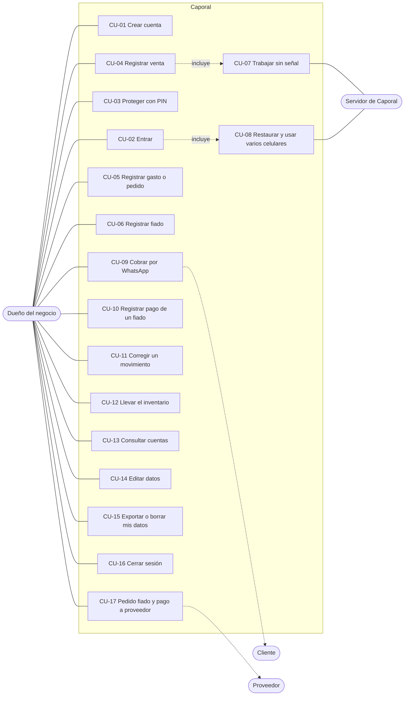

# 3. Casos de uso

Formato de cada caso: actor, precondición, flujo principal, alternativas y excepciones, reglas del negocio, resultado y dónde está en el código. "App" se refiere a `mobile/lib/` y "API" a `backend/src/main/java/co/caporal/api/`.

---

## CU-01 Crear cuenta

- **Actor:** dueño del negocio. **Precondición:** no tiene cuenta con ese celular. No necesita Internet.
- **Flujo principal** (formulario guiado, una pregunta por pantalla con botón "Seguir"):
  1. Escribe su nombre, celular (10 números, empieza por 3) y, si quiere, su correo.
  2. Escribe el nombre del negocio, elige el tipo (Tienda, Restaurante, Taller, Peluquería, Ropa, Droguería, Ambulante, Servicios u Otro) y el municipio. El tipo adapta la app: categorías de productos, gastos frecuentes, ganancia recomendada y ejemplos.
  3. Crea una clave de mínimo 8 caracteres (no puede ser su celular).
  4. Lee qué se guarda y para qué, y marca que autoriza el tratamiento de sus datos (Ley 1581).
  5. Pulsa "Crear mi cuenta": el servidor crea la cuenta y abre la sesión.
- **Alternativas:** el correo y el permiso de compartir cifras anónimas son opcionales.
- **Sin Internet:** la cuenta queda creada en el celular y se puede trabajar de una vez; el inicio dice "Su cuenta se termina de crear cuando tenga Internet". Al volver la señal, la app la crea en el servidor y envía todo lo anotado. La clave espera cifrada en el almacén seguro del sistema solo hasta ese envío.
- **Otra cuenta en el celular:** si el celular tiene datos de otra cuenta, avisa y los quita antes de crear la nueva (si hay anotaciones sin enviar, lo advierte en rojo), para que no se mezclen ni se vean.
- **Excepciones:** celular ya registrado → con Internet, "Ese celular ya está registrado"; si se creó sin Internet, al volver la señal pide entrar con la clave y lo anotado pasa a esa cuenta. Dato inválido → la app explica qué corregir y no avanza.
- **Reglas:** la clave se guarda con Argon2id; la autorización queda con fecha (`acepta_datos_en`).
- **Resultado:** cuenta creada, sesión abierta, pantalla de inicio.
- **Código:** App `ui/cuenta/pantalla_registro.dart`, `sincronizacion/sesion.dart`. API `cuenta/aplicacion/RegistrarNegocio`.

## CU-02 Entrar

- **Actor:** dueño. **Precondición:** tiene cuenta y señal.
- **Flujo principal:** escribe celular y clave → la API valida → la app guarda los tokens en el almacén seguro del sistema → si el teléfono no tiene los datos de la cuenta, ejecuta CU-08 → muestra el inicio.
- **Otro número en el mismo celular:** igual que al crear la cuenta, los datos de la cuenta anterior se quitan del celular (siguen en el servidor) antes de cargar los del número que entra.
- **Excepciones:** datos errados → "Celular o clave incorrectos" (igual mensaje si el celular no existe, para no revelar cuentas); 5 intentos fallidos → la cuenta se bloquea 15 minutos; olvidó la clave → la app indica escribir a soporte desde Ayuda.
- **Reglas:** el acceso dura 15 minutos y se renueva solo; el token de renovación es de un solo uso y dura hasta un año desde la última conexión.
- **Código:** App `ui/cuenta/pantalla_ingreso.dart`, `sincronizacion/sesion.dart`. API `cuenta/aplicacion/IngresarNegocio`, `Sesiones`.

## CU-03 Proteger con PIN

- **Actor:** dueño. **Flujo:** en Ajustes crea un PIN de 4 números; al abrir la app se pide el PIN.
- **Alternativa:** con PIN creado y si el celular tiene huella o Face ID, puede activar "Huella o Face ID" (confirmándola una vez). Al abrir la app se pide la huella o la cara; si no coincide o la cancela, escribe el PIN. Quitar el PIN apaga la huella.
- **Excepción:** 5 PIN errados seguidos → espera de 30 segundos.
- **Regla:** es un candado de comodidad para que otra persona no vea las cuentas; los datos ya están cifrados en el teléfono.
- **Código:** `ui/cuenta/pantalla_pin.dart`, `datos/biometria.dart`, `ui/ajustes/pantalla_ajustes.dart`. La huella y la cara las verifica el sistema; Caporal no las ve ni las guarda.

## CU-04 Registrar venta

- **Actor:** dueño. **Precondición:** sesión abierta (no necesita señal).
- **Flujo principal:**
  1. Toca "Vendí".
  2. Toca los productos que lleva el cliente: cada toque suma uno y el total se calcula solo; con − y + ajusta cantidades. Para encontrarlos rápido usa el **buscador** (no importan tildes ni mayúsculas: "cafe" encuentra "Café") o toca una **categoría**. O escribe el valor en el teclado.
  3. Elige cómo le pagaron (Efectivo o Bre-B) y pulsa "Guardar".
- **Alternativas:** el producto no existe → "+ Nuevo" (formulario guiado: nombre, precio, si se cuenta, cantidad actual) y queda agregado a la venta.
- **Reglas:** la venta, el descuento de inventario y la entrada en la cola se guardan en una sola transacción: o queda todo o nada. Los productos sin control de cantidad no generan movimientos de inventario.
- **Resultado:** venta en el historial, inventario descontado, pendiente de enviar.
- **Código:** `ui/anotar/pantalla_registrar.dart`, `ui/anotar/lista_venta.dart`, `datos/repositorio.dart`, `datos/inventario.dart`.

## CU-05 Registrar gasto o pedido

- **Actor:** dueño. **Flujo:** toca "Gasté", elige la categoría (Pedido, las propias de su tipo de negocio, por ejemplo Gas en un restaurante o Herramientas en un taller, y Otro), escribe el valor y guarda.
- **Alternativa "Pedido":** indica qué productos llegaron, cuántos y, si quiere, **cuánto le costó cada uno**; el inventario suma esas unidades y el costo queda en el producto. Si con ese costo gana menos de lo que eligió, la app ofrece subir el precio al sugerido. Si un producto no llevaba cuenta, empieza a llevarla.
- **Proveedor:** en un pedido escribe de quién es o toca uno que ya usó. Si el proveedor se lo fió, ver CU-17.
- **Código:** `ui/anotar/pantalla_registrar.dart`, `ui/anotar/panel_pedido.dart`, `dominio/tipos_de_negocio.dart`.

## CU-06 Registrar fiado

- **Actor:** dueño. **Flujo:** toca "Fié", elige o escribe el nombre del cliente, agrega productos o valor y guarda.
- **Alternativa:** debajo del nombre puede escribir el celular del cliente (opcional) y marcar que el cliente aceptó que lo guarde; así queda listo para cobrarle por WhatsApp. Sin esa autorización no se guarda y la app lo explica. Si el cliente ya tiene celular guardado, lo muestra.
- **Reglas:** el fiado descuenta inventario como una venta y suma a "Le deben"; el celular del cliente nunca sale del teléfono.
- **Código:** `ui/anotar/pantalla_registrar.dart`, `datos/clientes.dart`.

## CU-07 Trabajar sin señal y sincronizar

- **Actor:** dueño (indirecto) y servidor.
- **Flujo principal:** cada anotación queda en la base local cifrada y en la cola de salida → al haber señal, la app envía primero productos e inventario y después los movimientos, por lotes → el servidor guarda solo lo nuevo y confirma los ids → la app los saca de la cola → el inicio muestra "Copia de seguridad al día".
- **Excepciones:** sin señal → "Sin señal · todo queda guardado en su celular"; acceso vencido → la app lo renueva y sigue; sesión cerrada en el servidor → aviso "Entre de nuevo para guardar su copia de seguridad", sin perder nada del teléfono.
- **Reglas:** reenviar no duplica (ids únicos generados en el teléfono); un error en el servidor deja todo en la cola para reintentar.
- **Código:** `sincronizacion/sincronizador.dart`, `envio_catalogo.dart`, `envio_movimientos.dart`. API `sincronizacion/aplicacion/RecibirMovimientos`, `catalogo/aplicacion/SincronizarCatalogo`.

## CU-08 Restaurar y usar varios celulares

- **Actor:** dueño y servidor. **Precondición:** la app fue reinstalada o es otro celular; hay señal.
- **Flujo principal:** al entrar (CU-02), la app trae el perfil del negocio (nombre, tipo, municipio, llave Bre-B, datos de quien atiende) y pide el respaldo por páginas de 500 → guarda productos, movimientos e inventario sin volver a encolarlos → muestra "Trayendo sus datos guardados…" mientras tanto → al terminar, el inicio muestra todo.
- **Excepciones:** sin señal o error → lo intenta en la siguiente sincronización; acceso vencido → renueva y reintenta.
- **Varios celulares:** con la misma cuenta abierta en dos celulares, cada uno trae cada minuto (con señal) lo que anotó el otro, y también el perfil si lo cambiaron.
- **Reglas:** restaurar dos veces no duplica; lo anotado en el teléfono se conserva; en productos gana el cambio más reciente. Lo que nunca llegó al servidor (anotado sin señal y con la app borrada antes de enviarlo) no se puede recuperar.
- **Código:** App `sincronizacion/restauracion.dart`, `sincronizacion/sincronizador.dart`. API `respaldo/aplicacion/EntregarCambios`.

## CU-09 Cobrar por WhatsApp

- **Actor:** dueño; destinatario: cliente. **Precondición:** el cliente debe y hay celular autorizado (o se escribe en el momento).
- **Flujo:** en "Le deben" toca el cliente → "Cobrar por WhatsApp" → la app arma un mensaje amable con el saldo, las fechas de los fiados y la llave Bre-B del negocio → el dueño lo envía desde su propio WhatsApp.
- **Reglas de cobro respetuoso:** entre semana de 7 a. m. a 7 p. m.; sábados de 8 a. m. a 3 p. m.; domingos no; si se le recordó hace menos de 7 días, la app lo advierte. Fuera de horario la app no bloquea: muestra el aviso y pregunta "¿Enviar de todos modos?"; el dueño decide. El mensaje nunca habla de intereses, recargos ni reportes.
- **Código:** `ui/clientes/pantalla_cobrar.dart`, `dominio/reglas_cobro.dart`.

## CU-10 Registrar pago de un fiado

- **Actor:** dueño. **Flujo principal** (formulario guiado):
  1. "Ya me pagó" → elige "Todo" o "Una parte" (y el valor).
  2. Elige cómo le pagó: Efectivo, Bre-B o Transferencia.
  3. Si fue digital: escribe el número del comprobante (opcional) y puede tomar o elegir la foto del comprobante.
  4. Confirma que ya vio la plata en su cuenta y guarda.
- **Excepciones:** el valor supera la deuda → la app lo indica; el comprobante ya se usó en otro pago vigente → avisa con fecha, cliente y valor y no guarda; no marcó que vio la plata → no deja guardar.
- **Reglas:** el número se normaliza (sin espacios ni puntos, en mayúsculas) para detectar repetidos; la foto queda solo en el teléfono.
- **Resultado:** abono que baja la deuda, con forma de pago y comprobante en su detalle.
- **Código:** `ui/clientes/pantalla_registrar_pago.dart`, `datos/comprobantes.dart`. API valida forma de pago y comprobante en `sincronizacion/web/SyncDtos`.

## CU-11 Corregir un movimiento

- **Actor:** dueño. **Flujo:** abre el movimiento en el historial → "Corregir" → confirma → se anota un reverso que lo anula y la pantalla se abre **con los mismos datos** (valor, productos y cantidades, forma de pago, cliente) para cambiar solo lo que estaba mal.
- **Excepción:** un fiado que ya fue pagado (total o en parte, de forma que quitarlo dejaría al cliente con plata a favor) no se corrige directamente: la app pide corregir primero el pago.
- **Reglas:** nada se borra; el reverso devuelve las unidades al inventario y, si era un pago, libera su comprobante. Un movimiento ya corregido no se corrige dos veces.
- **Código:** `ui/movimientos/pantalla_detalle.dart`, `datos/repositorio.dart`.

## CU-12 Llevar el inventario

- **Actor:** dueño. **Flujos:** crear producto (formulario guiado, con categoría opcional de una lista fija: Bebidas, Aseo, …); editar nombre, precio, costo o categoría; anotar que llegó mercancía; contar lo que hay (se anota solo la diferencia); quitar un producto (se oculta y conserva su historial).
- **Costo y precio:** al crear un producto pregunta a cuánto lo compra (opcional) y deja escrito el precio sugerido para ganar el margen del negocio (15–30 %, elegido en Mi negocio), redondeado a un valor de tienda y hacia arriba. Al editar muestra "Gana $ X por cada una (Y %)" mientras escribe. El inventario muestra cuánto costó lo guardado y el inicio "Ganancia en lo vendido" del día (precio de venta menos costo, descontando ventas corregidas, con el costo de la última compra).
- **Reglas:** la cantidad es la suma de los movimientos de inventario; avisa "Quedan N" con 5 o menos y "Agotado" en 0. El costo es opcional: sin él todo funciona como antes.
- **Código:** `ui/inventario/`, `datos/inventario.dart`.

## CU-13 Consultar cuentas

- **Actor:** dueño. **Flujo:** el inicio muestra lo que ganó hoy (ventas − gastos), lo que le deben, lo que debe a proveedores (si debe algo), el valor del inventario y lo último; "Resumen" muestra la semana; "Historial" agrupa por día y mes.
- **Código:** `ui/inicio/pantalla_inicio.dart`, `ui/movimientos/`.

## CU-14 Editar datos personales y del negocio

- **Actor:** dueño. **Flujo:** en Ajustes, "Mis datos personales" (nombre, correo) y "Mi negocio" (nombre, tipo, municipio, cuánto quiere ganar en cada producto, llave Bre-B), cada uno como formulario guiado.
- **Reglas:** el celular es el usuario y no se cambia desde la app. Cada cambio queda pendiente y se envía al servidor con su hora; si dos celulares lo cambian, gana el más reciente. Si el envío falla, las ventas y fiados se siguen enviando igual.
- **Código:** `ui/ajustes/pantalla_mis_datos.dart`, `ui/ajustes/pantalla_mi_negocio.dart`, `sincronizacion/sincronizacion_perfil.dart`. API `cuenta/aplicacion/GestionarPerfil`.

## CU-15 Exportar o borrar mis datos (Ley 1581)

- **Actor:** dueño. **Flujos:** "Copiar mis datos" copia todo lo que anotó para pegarlo en un mensaje o documento; "Eliminar mis datos" pide escribir ELIMINAR y borra la cuenta en el servidor y todo lo del teléfono, incluidas las fotos de comprobantes.
- **Excepción:** sin señal no se puede borrar la copia del servidor, y en ese caso no se borra nada para que pueda reintentar.
- **Código:** `ui/ajustes/pantalla_privacidad.dart`. API `cuenta/aplicacion/EliminarCuenta`.

## CU-16 Cerrar sesión

- **Actor:** dueño. **Flujo:** en Ajustes, "Cerrar sesión" → la app avisa al servidor que ese token de renovación ya no sirve y lo borra del teléfono. Al volver a entrar se ejecuta CU-08.
- **Código:** `sincronizacion/sesion.dart`. API `cuenta/web/SesionController` (`/auth/salir`).

## CU-17 Pedido fiado y pago a proveedor

- **Actor:** dueño; el proveedor es externo (no usa la app). **Precondición:** ninguna; funciona sin Internet.
- **Flujo principal:**
  1. Toca "Gasté" → "Pedido", toca los productos que llegaron con su cantidad y costo.
  2. En la forma de pago elige **"Me lo fiaron"** y escribe o toca el proveedor (obligatorio).
  3. Escribe el valor del pedido y toca "Anotar lo que debo".
  4. Cuando le paga: Deudas → **Le debo** → proveedor → "Ya le pagué" (abre con lo que debe; puede pagar una parte) → Efectivo o Bre-B → "Guardar pago".
- **Reglas:**
  - El pedido fiado suma al inventario y actualiza el costo, pero **no** cuenta como gasto del día: la plata todavía no sale. El pago sí cuenta como gasto.
  - "Le debo" = pedidos fiados − pagos, por proveedor. El inicio muestra el total si es mayor que cero.
  - Un pedido fiado que ya se empezó a pagar no se corrige directamente: primero se corrige el pago (igual que un fiado de cliente).
  - Se guarda como movimiento `COMPRA` (pedido fiado) o `PAGO` (pago al proveedor); el nombre del proveedor va en `clienteNombre`.
- **Resultado:** el dueño sabe cuánto le debe a cada proveedor y cuánto le ha pedido en el mes.
- **Código:** App `ui/anotar/pantalla_registrar.dart`, `ui/anotar/panel_pedido.dart`, `ui/clientes/pantalla_deudores.dart`, `ui/proveedores/pantalla_proveedor.dart`, `datos/repositorio.dart`. API `sincronizacion/dominio/TipoMovimiento`.
