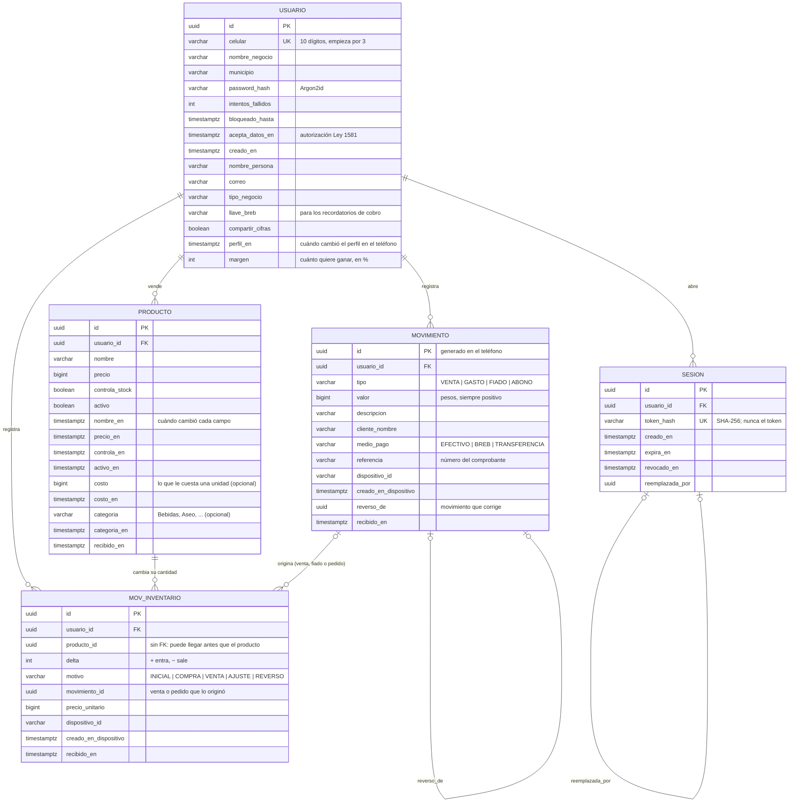
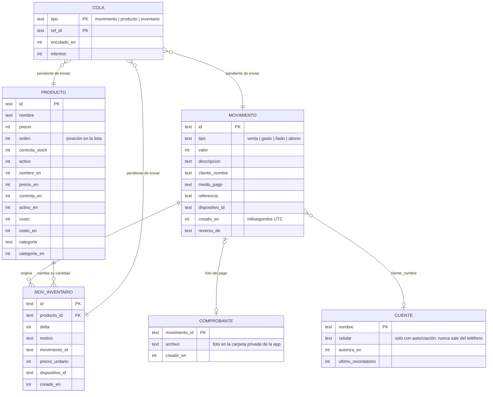

# 4. Modelo entidad-relación

Caporal guarda los datos en dos lugares con el mismo modelo de fondo: **PostgreSQL** en el servidor (copia de seguridad de todos los negocios) y **SQLite cifrada con SQLCipher** en cada teléfono (los datos de un solo negocio, más lo que nunca sale del teléfono).

Principios del modelo:

- **Inmutabilidad:** `movimiento` y `mov_inventario` solo se insertan. Corregir es agregar un reverso. La única excepción es el borrado de la cuenta (Ley 1581).
- **Ids generados en el teléfono (UUID):** hacen idempotente la sincronización.
- **Aislamiento:** toda tabla del servidor lleva `usuario_id` y toda consulta filtra por él.
- **Cantidad derivada:** el inventario de un producto es la suma de sus `mov_inventario.delta`; no se guarda un número que pueda desincronizarse.

## Servidor (PostgreSQL)

### Diccionario de datos del servidor

| Tabla | Para qué | Reglas |
|---|---|---|
| `usuario` | Cuenta y perfil del negocio | `celular` único; 5 intentos fallidos bloquean 15 minutos; claves bcrypt antiguas se migran a Argon2id al entrar; el perfil se reemplaza solo por uno con `perfil_en` más reciente |
| `movimiento` | Ventas, gastos, fiados y abonos | Inmutable; `valor > 0`; el signo lo da el `tipo`; `reverso_de` anula otro movimiento; índice por (`usuario_id`, `recibido_en`) |
| `producto` | Catálogo | Cada campo se fusiona por su `*_en` más reciente (también el costo, que es opcional: un envío sin costo no borra el guardado); un producto de otro negocio nunca se modifica |
| `mov_inventario` | Cambios de cantidad | Inmutable; `delta ≠ 0`; cantidad = suma de `delta` por producto |
| `sesion` | Tokens de renovación | Solo la huella SHA-256; un solo uso; reutilizar uno revocado revoca todas las sesiones del negocio |

Migraciones: `backend/src/main/resources/db/migration/V1__esquema_inicial.sql` (usuario, movimiento), `V2__catalogo_e_inventario.sql`, `V3__sesiones_y_hash.sql`, `V4__comprobante_de_pago.sql`, `V5__perfil_del_negocio.sql`, `V6__costo_y_margen.sql`, `V7__categoria_de_producto.sql`.

## Teléfono (SQLite + SQLCipher, versión 5)

### Diccionario de datos del teléfono

| Tabla | Para qué | Viaja al servidor |
|---|---|---|
| `movimiento` | Igual que en el servidor | Sí |
| `producto` | Igual que en el servidor, más `orden` para la lista | Sí (sin `orden`) |
| `mov_inventario` | Igual que en el servidor | Sí |
| `cliente` | Celular autorizado y fecha del último recordatorio | **No** (dato de un tercero) |
| `comprobante` | Foto del comprobante de un pago | **No** |
| `cola` | Lo que falta enviar; se borra al confirmarlo el servidor | No |

Fuera de la base, en el almacén seguro del sistema (Keychain en iOS, Keystore en Android): llave de cifrado de la base, token de acceso, token de renovación, PIN (con sal y hash) y perfil (con la hora de su último cambio y si falta enviarlo; el PIN nunca sale del teléfono).

Migraciones locales: `mobile/lib/datos/base_local.dart` (`version = 7`, de v2 a v7 sin pérdida de datos; probadas en `test/inventario_test.dart` y `test/pago_test.dart`).
